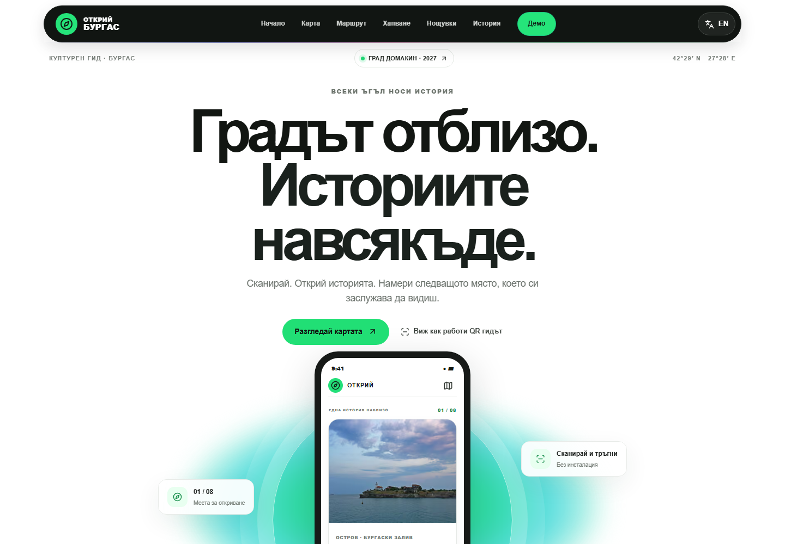
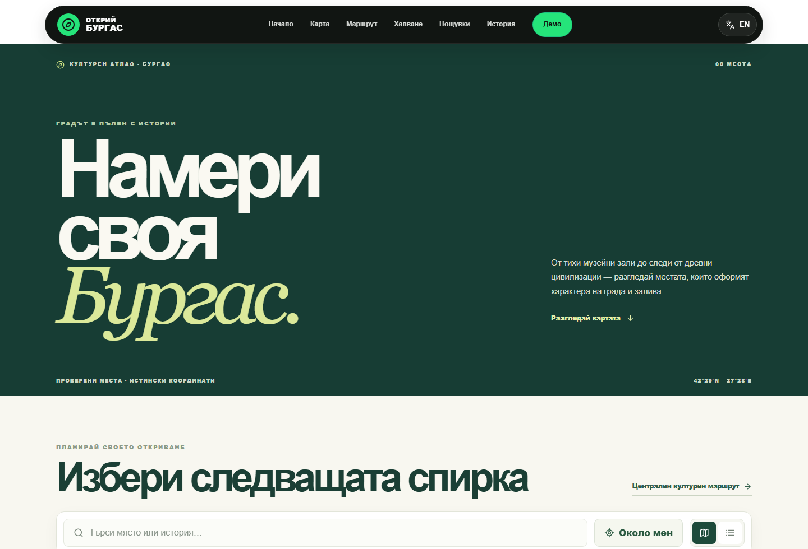
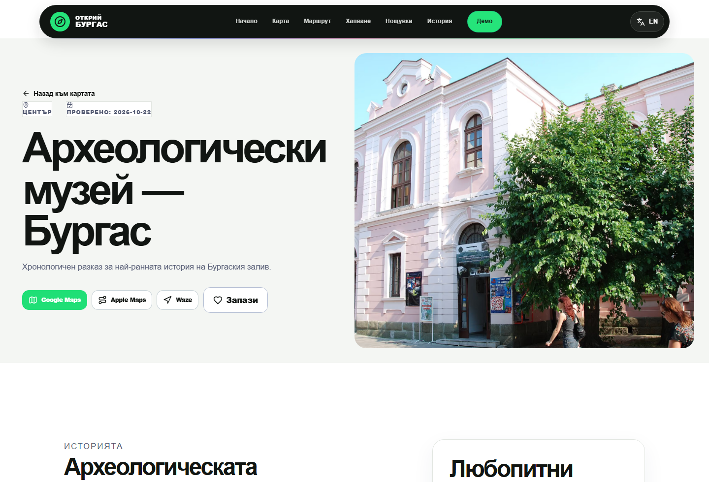
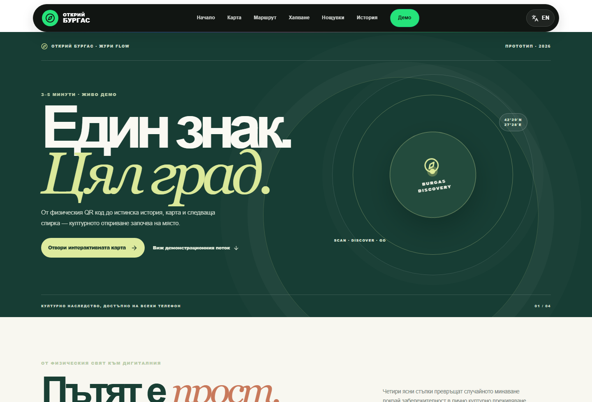

# Открий Бургас / Discover Burgas

> „Всяко място разказва история.“

Bulgarian-first, mobile-first cultural discovery platform built for a competition demonstration. A physical QR code opens a stable, language-neutral landmark URL; the visitor receives a localized historical story, verified sources, an interactive map, nearby places, directions, and a practical cultural route.

**Live production:** [discover-burgas.vercel.app/bg](https://discover-burgas.vercel.app/bg) · [jury demo](https://discover-burgas.vercel.app/bg/demo) · [interactive map](https://discover-burgas.vercel.app/bg/map)

This repository is an independent competition prototype. It does not claim endorsement by Burgas Municipality or any cultural institution, and the printable signs are proposals—not installed infrastructure.

## Preview

The live demo uses a bright, product-led presentation inspired by the layout and storytelling rhythm of modern app launch sites: concise promise, a real mobile-place preview, restrained spectral motion, and spacious feature sections. Discover Burgas keeps its own writing, heritage photography, data, and brand. The design rules are in [docs/DESIGN_DIRECTION.md](docs/DESIGN_DIRECTION.md).

| Home — desktop | Home — mobile |
|---|---|
|  |  |

| Interactive map | Landmark page |
|---|---|
|  |  |

The [actual rendered preview set](screenshots/aevo-inspired/) includes the 375, 390, 768, 1024 and 1440 px home layouts, the map, place detail, and jury demo.

The [production capture set](screenshots/production/) was rendered directly from the deployed HTTPS application after the Vercel release completed.



## Working MVP

- Fourteen sourced locations across Burgas, Nessebar, Pomorie, Sozopol and Primorsko, including confirmed Eurovision 2027 venue Arena Burgas
- Bulgarian and English public routes
- Stable QR targets at `/places/[slug]`
- SVG and PNG QR downloads generated from `NEXT_PUBLIC_APP_BASE_URL`
- Leaflet/OpenStreetMap discovery with search, categories, map/list views, opt-in location, and a text fallback
- Haversine-based nearby recommendations
- One-tap routing through Google Maps, Apple Maps, or Waze using keyless universal links
- Five-stop central walking route plus north-coast driving and south-coast mixed regional routes; Aquae Calidae is transport-dependent and St. Anastasia is boat-dependent
- Local-only favorites, no account or tracking
- Printable sign proposal and jury demo mode
- PWA manifest, offline explanation, and conservative application-shell service worker
- Zod manifests, Supabase/PostgreSQL migrations, RLS policies, and repeatable TypeScript seed
- Unit, browser, QR decode, five-viewport, keyboard, and multi-page automated accessibility checks
- Bright, phone-led product presentation with a compact capsule navigation, an original violet–magenta–cyan stage palette, restrained motion, and reduced-motion support
- Source-backed city and platform story at `/bg/story` and `/en/story`
- Visitor issue reporting and a token-protected configuration health dashboard at `/admin`
- Interactive phone walkthrough with four working states and working story, map and directions links
- Centered mobile-place preview with working map, QR, route, and local-favorite links; full-screen map and place stories remain accessible below
- Curated dining page with venue-source links and category filters; external Booking.com and Airbnb search handoff with explicit disclosure
- Bilingual source and image-credit page at `/bg/sources` and `/en/sources`

## Stack

Next.js 16 App Router, React 19, TypeScript, Tailwind CSS 4, Leaflet, Supabase PostgreSQL, Zod, Vitest, Playwright, axe-core, and a Python REST verifier. The application is deployed on Vercel with Supabase as the production backend.

The public pages and APIs read live published records from Supabase when `CONTENT_BACKEND=supabase`. The version-controlled, Zod-validated manifest in `src/data/landmarks.ts` remains the auditable seed and an explicit local fallback only.

## Local setup

Requirements: Node.js 22 and npm. Docker is required only for the optional local Supabase stack.

```bash
npm install
copy .env.example .env.local
npm run dev
```

Open `http://localhost:3000/bg`. The jury entry point is `http://localhost:3000/bg/demo`.

### Database

Create/link a Supabase project, apply the migrations, then seed and verify:

```bash
npx supabase login
npx supabase link --project-ref <project-ref>
npm run supabase:push
npm run supabase:seed
npm run backend:verify
```

The seed requires a server secret, or the documented short-lived RLS seed-token procedure. Never place `SUPABASE_SECRET_KEY` in a `NEXT_PUBLIC_` variable. For a fully local Supabase stack, use the repository scripts on a machine with Docker:

```bash
npm run supabase:start
npm run supabase:reset
npm run supabase:lint
npm run supabase:test
```

Supabase is the only supported database workflow. The previous parallel Prisma schema and generated client were removed to prevent migration drift. Docker was not available on the implementation machine, so local pgTAP execution remains a CI/compatible-machine gate.

## Quality commands

```bash
npm run lint
npm run typecheck
npm test
npm run build
npm run test:e2e
npm run screenshots
npm run screenshots:design
npx playwright test --config playwright.redesign.config.ts
```

Playwright browsers may first require `npx playwright install chromium`. See [the QA report](docs/QA_REPORT.md) for results that were actually executed.

## Vercel and Supabase deployment

1. Create a Supabase project and apply `supabase/migrations/`.
2. Import this repository into Vercel.
3. Configure `NEXT_PUBLIC_SUPABASE_URL`, `NEXT_PUBLIC_SUPABASE_PUBLISHABLE_KEY`, server-only `SUPABASE_SECRET_KEY`, `CONTENT_BACKEND=supabase`, and `NEXT_PUBLIC_APP_BASE_URL=https://<production-domain>`.
4. Run `npm run supabase:seed` and `npm run backend:verify`.
5. Deploy, then regenerate/verify printable QR assets against the HTTPS domain.
6. Complete a real smartphone-camera scan before public presentation.

The Supabase project is provisioned, migrated and seeded. Vercel production is live at [discover-burgas.vercel.app](https://discover-burgas.vercel.app), and the generated QR payload was decoded successfully to the final HTTPS landmark URL. A physical smartphone-camera scan remains the final venue/device check before the presentation.

### Maps configuration

Visitor navigation does **not** require a Google Maps API key. The application uses official Google Maps URLs, Apple Maps unified URLs, and Waze Deep Links, while the in-page discovery map remains Leaflet/OpenStreetMap.

Dining venue photography supports the official Google Places API (New) via the server-only `GOOGLE_PLACES_API_KEY`. Add this key only after enabling Places API (New) and billing in Google Cloud; restrict it to Places API and set quotas/budget alerts. Never add it with the `NEXT_PUBLIC_` prefix or commit a real value. With no key configured, the cards use a branded illustrative fallback. The venue-photo endpoint is live-requested and sends `Cache-Control: no-store` to respect Google Places content rules. Existing Google/Apple/Waze direction links do not need a key. See [Google Place Photos](https://developers.google.com/maps/documentation/places/web-service/place-photos) and [DATA_SOURCES](docs/DATA_SOURCES.md).

### Protected operations view

Set `ADMIN_DASHBOARD_TOKEN` to a long random value to unlock `/admin`. Visitor submissions pass through the validated, rate-limited Next.js server endpoint and are written with the server-only Supabase secret. Anonymous and authenticated database roles cannot call the report RPC or read/write the report table directly. Admin sessions are signed and expire after four hours; records older than 90 days are removed on new report submission and protected inbox access.

## Burgas 2027 information

Burgas is the confirmed Host City for Eurovision 2027, with the live shows scheduled at Arena Burgas on 11, 13, and 15 May 2027. The project links to official EBU/BNT information and does not invent unannounced Eurovision Village, EuroClub, ticket, or transport details.

This repository is an independent cultural-technology prototype and is not affiliated with or endorsed by Eurovision, the EBU, BNT, or Burgas Municipality. Its event-inspired graphics are original and do not reuse the official event logo.

## Documentation

- [Architecture](docs/ARCHITECTURE.md)
- [Backend and API contracts](docs/BACKEND.md)
- [Data and image sources](docs/DATA_SOURCES.md)
- [QR system](docs/QR_SYSTEM.md)
- [3–5 minute jury demo](docs/DEMO_GUIDE.md)
- [Roadmap](docs/ROADMAP.md)
- [Executed QA](docs/QA_REPORT.md)
- [Final implementation report](docs/FINAL_IMPLEMENTATION_REPORT.md)
- [Rendered screenshots](screenshots/)

